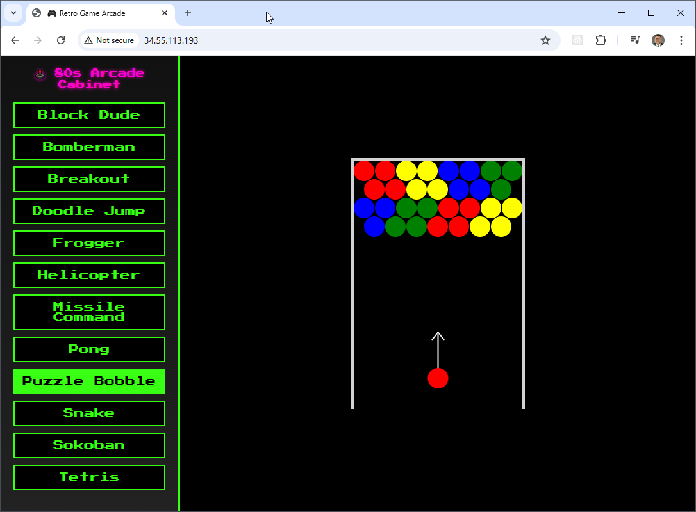
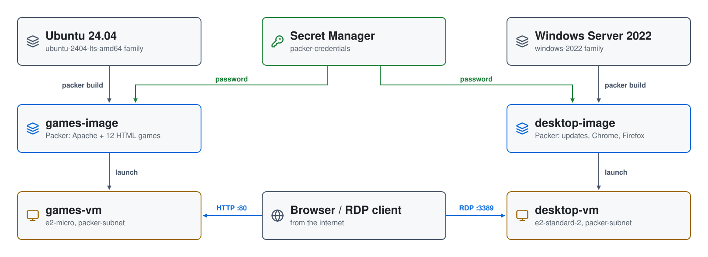
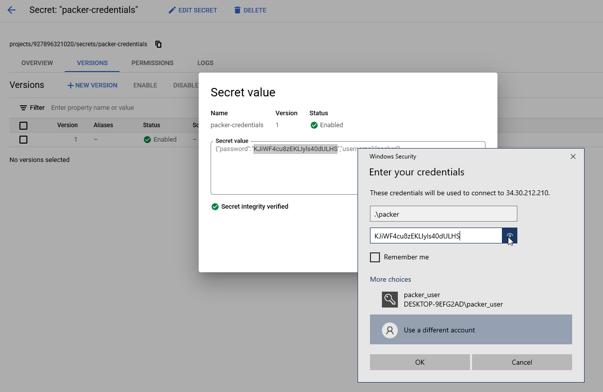
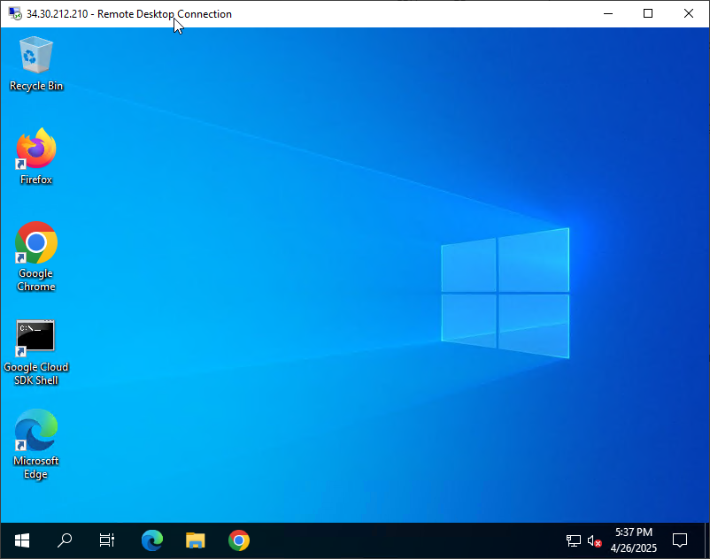

# Building VM Images with Packer on GCP

Two custom Compute Engine images built with **Packer** and deployed with
**Terraform**: a Linux **games** image, Ubuntu 24.04 with Apache serving a
dozen retro HTML games, and a Windows **desktop** image, Windows Server 2022
with the latest updates, Chrome and Firefox. Both images carry a local
`packer` account whose password comes from Secret Manager, and Terraform
launches one VM from each.



| Piece | Where | Role |
|---|---|---|
| **games-image** | image family `games-images` | Ubuntu 24.04 + Apache + 12 HTML games, `packer` sudo user, 20 GB disk |
| **desktop-image** | image family `desktop-images` | Windows Server 2022 + Windows updates, Chrome, Firefox, `packer` admin user, 128 GB disk; sysprepped |
| **games-vm** | `packer-subnet`, `us-central1-a` | `e2-micro` from the newest games image; public IP |
| **desktop-vm** | `packer-subnet`, `us-central1-a` | `e2-standard-2` from the newest desktop image; public IP |
| **Secret Manager** | global | `packer-credentials`: the `packer` user and a generated password |

## Architecture

<picture>
  <source media="(prefers-color-scheme: dark)" srcset="architecture-dark.svg">
  
</picture>

Regenerate with `python3 make_diagram.py`.

- **`01-infrastructure/`**: the VPC (`packer-vpc`) with `packer-subnet`
  (10.0.0.0/24), the firewall rules, and the `packer-credentials` secret.
- **`02-packer/linux/`**: `linux_image.pkr.hcl`, the HTML games, and the
  install and user scripts.
- **`02-packer/windows/`**: `windows_image.pkr.hcl` and the PowerShell
  provisioners.
- **`03-deploy/`**: the two VMs, launched from the newest image in each
  family, which `apply.sh` looks up.

## How the images are built

**Linux**:

1. Copies `html/` to the build VM and installs Apache, which serves the games
   from `/var/www/html`.
2. Creates the `packer` user with the secret's password and passwordless sudo.

The Linux template doesn't set a network, so Packer builds it on the
project's `default` VPC.

**Windows** (in `packer-vpc`, tagged `allow-winrm` and `allow-rdp`):

1. A `windows-startup-script-cmd` in the build VM's metadata runs
   `winrm quickconfig`, creates a `packer_user` administrator with the
   secret's password, and turns on WinRM Basic auth. Packer connects as
   `packer_user` over WinRM HTTPS (5986).
2. Installs every available Windows update, then reboots.
3. Creates the `packer` user in Administrators and Remote Desktop Users,
   installs Chrome and Firefox, and cleans up the desktop.
4. Runs `Sysprep /generalize /shutdown`, so each VM boots clean.

## Firewall rules

```
internet ─80, 22─▶ games-vm
internet ─3389──▶ desktop-vm
internet ─5986──▶ the Windows build VM (WinRM)
```

| Rule | Port | Applies to |
|---|---|---|
| `allow-http` | tcp 80 | every VM in `packer-vpc` |
| `allow-ssh` | tcp 22 | tag `allow-ssh` (games-vm) |
| `allow-rdp` | tcp 3389 | tag `allow-rdp` (desktop-vm, Windows build VM) |
| `allow-winrm` | tcp 5986 | tag `allow-winrm` (Windows build VM) |

All four allow `0.0.0.0/0`. The games VM's startup script turns on SSH
password logins, so `packer` can sign in over SSH.

## Prerequisites

* [A Google Cloud Account](https://console.cloud.google.com/)
* [Install gcloud CLI](https://cloud.google.com/sdk/docs/install)
* [Install Terraform](https://developer.hashicorp.com/terraform/install)
* [Install Packer](https://developer.hashicorp.com/packer/install)
* [Install jq](https://jqlang.github.io/jq/download/)

Put a service account key in the repository root as `credentials.json`.
Terraform and Packer both use it; `check_env.sh` activates it, and
`api_setup.sh` enables the APIs the build needs. If this is your first time
watching our content, we recommend starting with this video:
[GCP + Terraform: Easy Setup](https://youtu.be/3spJpYX4f7I).

## Deploy

```bash
git clone https://github.com/mamonaco1973/gcp-packer.git
cd gcp-packer
./api_setup.sh   # first time in a project
./apply.sh       # 1: VPC + secret  2: games and desktop images (Packer)  3: VMs
```

Everything deploys to `us-central1`. The Packer phase takes the longest, at
least 20 minutes, most of it Windows updates. `apply.sh` ends by running
`validate.sh`:

```
============================================================
 Google Cloud Virtual Machine Endpoints
============================================================

 Desktop VM Public IP:
   203.0.113.20

 Games VM Public IP:
   203.0.113.10
   http://203.0.113.10
```

## Try it

1. Open the games URL and pick a game.
2. Get the `packer` password:

   ```bash
   gcloud secrets versions access latest --secret=packer-credentials \
     | jq -r .password
   ```

3. RDP to the desktop VM's IP as `.\packer`:

   

   

## Troubleshooting

| Symptom | Fix |
|---|---|
| The Linux build fails to create its VM | The project needs a `default` VPC network, which the Linux build uses. |
| The Windows build sits at "Waiting for WinRM" | The metadata startup script configures WinRM on first boot; give it several minutes, and check that outbound 5986 isn't blocked where you run Packer. |
| The Windows build takes a long time | Windows updates and the reboot after them. Expected. |
| `apply.sh` stops with "No latest image found" | A Packer build failed; re-run `apply.sh` and read the Packer output. |

## Teardown

```bash
./destroy.sh     # destroys the VMs, deletes the games and desktop images, then destroys the VPC and secret
```

## Notes

- **Lab only.** HTTP, SSH, RDP and WinRM are open to the internet, the
  `packer` account is an administrator on both images, and the Windows build
  turns on WinRM Basic auth. Restrict the firewall rules for anything more.
